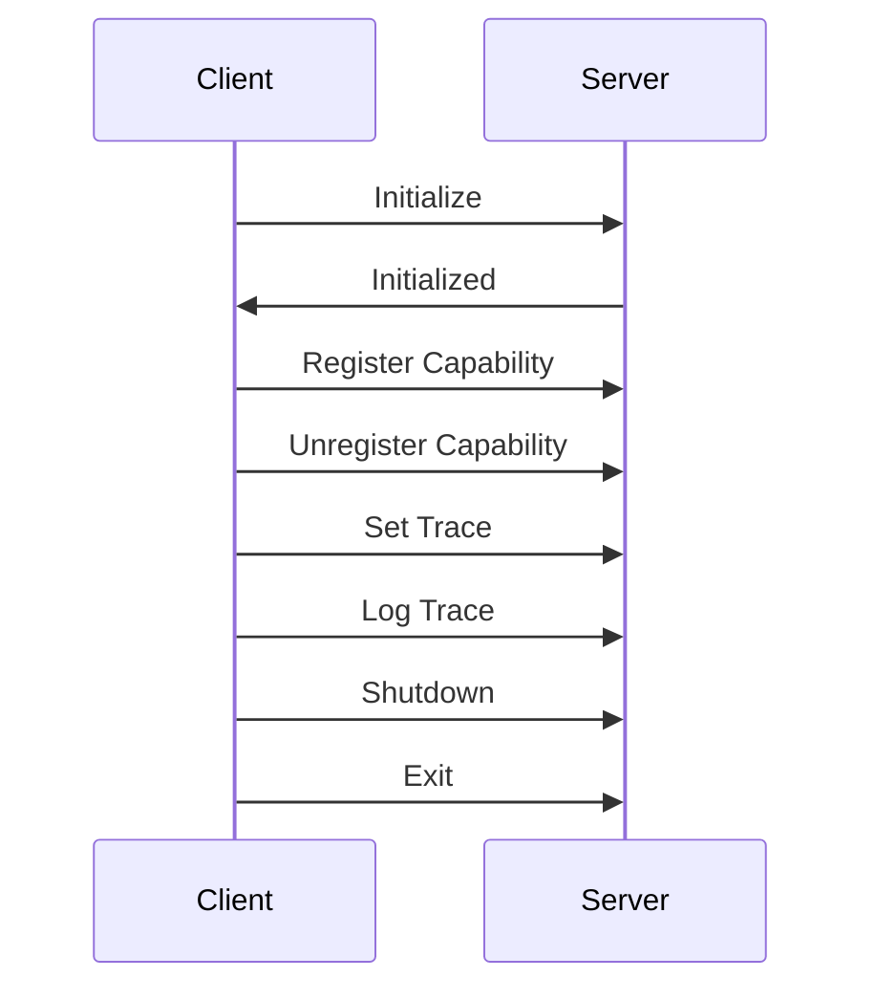

:::info Updated October 2026
When I wrote this in August 2025, "MCP is a contract" was a hunch. Since then, the specification itself has moved in that direction: the 2026-07-28 revision removed the `initialize` handshake and protocol-level sessions entirely. I've added what changed, and what it means, at the end of each section.
:::

Since its introduction, MCP has sparked fascinating discussions across developer communities, with both proponents and opponents.

When I first discovered MCP in late November 2024, I was immediately intrigued by its potential. It seemed like the missing piece in how we communicate with systems using natural language, a problem I was already trying to tackle with my CLI tools `gyat` and `hapi`. However, those tools worked algorithmically, with deterministic workflows; they couldn't systematically interact with AI models.

{/* truncate */}

Anthropic's MCP caught my attention because it **appeared to offer a solution**: a way to standardize natural-language communication with systems, for developers and users alike. Initially, I saw MCP as a protocol that could bridge the gap between human language and machine comprehension.

## My journey with MCP

I immediately began experimenting with MCP, integrating it into my tools and workflows. The simplicity of adding tools to Claude's desktop interface was compelling; it felt like a natural evolution beyond traditional APIs and protocols.

There was a catch, though. The initial learning curve was steep, and troubleshooting was hard. I wanted to help others facing the same struggles by making MCP more accessible without requiring deep technical understanding.

Through writing about my experiences, my understanding evolved along with the specification. A pivotal moment came when MCP introduced **Streamable HTTP** (protocol revision 2025-03-26) as a transport. That shift helped me realize that **MCP isn't purely a protocol; it's fundamentally a contract** that emphasizes interaction semantics rather than data-transfer mechanics.

Since my `gyat` and `hapi` CLI tools were designed to be API-first, MCP fit right in: it doesn't just define how systems communicate, it defines how they should behave.

## The LSP connection: understanding MCP's roots

To understand what MCP is, let's look at its foundation. Do you recognize this JSON structure?

```json
Content-Length: ...\r\n
\r\n
{
	"jsonrpc": "2.0",
	"id": 1,
	"method": "textDocument/completion",
	"params": {
		...
	}
}
```


What about these TypeScript interfaces?

```typescript
interface RequestMessage extends Message {
	/**
	 * The request id.
	 */
	id: integer | string;

	/**
	 * The method to be invoked.
	 */
	method: string;

	/**
	 * The method's params.
	 */
	params?: array | object;
}

interface ResponseMessage extends Message {
	/**
	 * The request id.
	 */
	id: integer | string | null;

	/**
	 * The result of a request. This member is REQUIRED on success.
	 * This member MUST NOT exist if there was an error invoking the method.
	 */
	result?: LSPAny;

	/**
	 * The error object in case a request fails.
	 */
	error?: ResponseError;
}
```

No, it isn't MCP. This is the [**Language Server Protocol (LSP)**](https://microsoft.github.io/language-server-protocol/specifications/lsp/3.17/specification/#contentPart), which standardizes how development tools talk to programming-language servers. LSP lets editors and IDEs offer code completion, linting and refactoring **across languages, without language-specific logic in each tool**.

The lifecycle message flows of LSP and the original MCP were strikingly similar:




### Why LSP matters for understanding MCP

LSP revolutionized software development by solving an integration problem. Before LSP, supporting code intelligence meant **M × N integrations: M languages for N editors**, each one expensive and fragile.

LSP introduced a **universal interface**. Once a language server was built, any LSP-compliant editor could use it.

**Sound familiar?** That's exactly what MCP does for AI: *once an API is exposed as an MCP server, any compliant client can use it without custom logic for each client.*

:::note What changed in 2026
MCP has since parted ways with LSP's lifecycle. In the [2026-07-28 revision](https://modelcontextprotocol.io/specification/2026-07-28/changelog), the `initialize` / `notifications/initialized` handshake is gone, and so are protocol-level sessions and the `Mcp-Session-Id` header. Every request now carries its own protocol version and client capabilities in `_meta`, and servers advertise what they support through a new `server/discover` request. MCP kept LSP's best idea, one interface for many clients, and dropped the stateful ceremony.
:::

## The strategic launch: lucky or smart?

**Timeline:**

- MCP SDK made [public on GitHub: October 23, 2024](https://github.com/modelcontextprotocol/typescript-sdk/releases/tag/0.1.0)
- Claude desktop [released: October 31, 2024](https://docs.anthropic.com/en/release-notes/claude-apps#october-31st%2C-2024)

Much of the early buzz around MCP came from Claude desktop, the first MCP client. Anthropic made a smart move by recognizing LSP's potential and applying the same principles to AI model interactions.

The choice of `stdio` as the first transport was controversial, but it was strategically sound: lightweight and direct, ideal when client and server run on the same machine, which was the case for Claude desktop and the first MCP servers.

### Understanding stdio

**stdio (standard input/output)** comes from the C runtime and UNIX-like systems, and consists of three standard streams:

- **stdin** (0): input
- **stdout** (1): output
- **stderr** (2): errors

They're just **file streams**, attached to terminals, pipes or redirects. stdio is a transport for higher-level protocols.

**Analogy:** if **HTTP is postal mail**, stdio is **passing notes through a tube**: simpler and faster when sender and receiver sit side by side.


The community's push toward HTTP made sense: it's familiar, widely supported, and comes with headers, status codes and content negotiation. For me, [Streamable HTTP](https://modelcontextprotocol.io/specification/2025-03-26/basic/transports#streamable-http) in revision 2025-03-26 was transformative.

:::note What changed in 2026
Both transports remain standard, and the 2026-07-28 [transports page](https://modelcontextprotocol.io/specification/2026-07-28/basic/transports) states it plainly: "Protocol semantics are identical on every transport." On Streamable HTTP, each message is one HTTP POST to a single MCP endpoint. A transport is now explicitly just a *binding*. The meaning lives above it, in the contract.
:::

## MCP as a contract, not a protocol

This brings us to the core insight: **MCP is not just another protocol; it's a semantic layer** that enables **intelligent API interactions**. It lets agents understand not just the data, but the **intent and context** behind it.

Consider this question: *where do Swagger/OpenAPI (OAS) fit in a networking model such as OSI?*

They don't fit neatly, and that's fine. **Swagger/OAS isn't a protocol in the traditional sense; it's a contract** that defines how systems should interact.

### Why Swagger/OAS doesn't fit the OSI model

The **OSI model** describes **how** data moves across networks, from the physical wire (layer 1) to applications (layer 7).

Swagger/OAS, by contrast:

- doesn't handle **transport** (layer 4);
- doesn't define **sessions** (layer 5);
- isn't concerned with **encoding** (layer 6);
- isn't a **runtime application** (layer 7).

Instead, it:

- **describes APIs**: endpoints, parameters, responses and authentication;
- **acts as metadata** for client-service interactions over HTTP.

That's **meta-communication**, a **contract**, not transmission.

### The "layer 8" concept

I'd place Swagger in [**layer 8**](https://en.wikipedia.org/wiki/Layer_8): "people, policies and planning", where developers, product managers and architects live. It's about human **agreement**, **specification** and **negotiation** of service interfaces.

**Analogy:** if the OSI model is a road system:

- Layers 1–4 are the asphalt, traffic rules, intersections and cars.
- Layers 5–7 are the drivers, GPS and apps that send and receive instructions.
- **Swagger/OAS** is the *roadmap and city-planning documentation* that tells drivers and planners how the roads should be used.

### MCP operates in the intent layer

In **intent-based systems**, like MCP or autonomous agents, specifications such as Swagger or gRPC play a central role:

- declaring **intent**;
- providing **machine-readable contracts**;
- powering **automation, code generation, testing and governance**.

In modern cloud-native and AI-centric architectures, these specifications live in the intent and control plane, sometimes called **layer 8+** or **"layer 9: governance and compliance"**.

## Summary: contract vs protocol

| **Aspect** | **OSI equivalent** | **Why it's different** |
| --- | --- | --- |
| Describes APIs over HTTP | Above layer 7 | It's metadata, not data |
| Exists at design time | Layer 8 (people) | It's a contract, not a protocol |
| Used by developers and tools | Layer 8/9 | Focused on agreement and automation |
| Doesn't transmit data | Not in OSI | Doesn't live in the data plane |

**Key insight:** Swagger/OAS is what *developers* and *machines* use to agree **on how** to communicate, but it doesn't do the communicating itself.

In the same way, **MCP's value lives in "layer 8"**, the realm of contracts, conventions and collaboration. That's not a limitation; it's the evolution from "transporting data" to "understanding and automating intent".

:::note What changed in 2026
The evidence got stronger. A stateless MCP request is a self-contained message: which tool, which arguments, which protocol version. That's very close to a REST call described by an OpenAPI operation. In practice, the [HAPI CLI](https://hapi.mcp.com.ai) builds MCP tools directly from an OpenAPI contract: the `operationId` becomes the tool name, the parameters become its input schema, and GET operations are marked read-only. See [You don't need to implement MCP servers](/you-dont-need-to-implement-mcp-servers-a-contract-first-approach-to-ai-tool-integration) for the real output.
:::

## Contracts all the way up: agents get business cards

There's a new layer-8 citizen since I first wrote this. MCP connects an agent to its **tools**. The [Agent2Agent (A2A) protocol](https://a2a-protocol.org), an open-source Linux Foundation project contributed by Google, connects **agents to other agents**, and its documentation describes it as complementary to MCP.

How do agents find each other? Through an **Agent Card**: a public JSON document that declares the agent's name, what it does, where to reach it, and the skills it offers. That's not transport, it's a contract. The pattern repeats one level up: **OpenAPI for APIs, MCP for tools, Agent Cards for agents.**

## Why this matters: MCP's real value

Anthropic's insight was building on this intent-layer idea to make AI interactions more intuitive. MCP wasn't just another specification; it was a way to make AI practical.

When I finally understood **MCP as a contract rather than a protocol**, everything fell into place. The 2026 revision feels like the specification reaching the same conclusion.

## Looking forward: MCP in the enterprise

In regulated industries such as banking, healthcare and defense, contracts are paramount. An explicit semantic layer maps directly to compliance needs:

- **Audit trails:** every tool call is a named action with typed arguments, so it can be logged with its context.
- **Policy enforcement:** behavior hints such as `readOnlyHint` and `destructiveHint` let clients and gateways treat reads and writes differently.
- **Authorization:** MCP now has an [Authorization specification](https://modelcontextprotocol.io/specification/2026-07-28/basic/authorization) for HTTP, based on OAuth 2.1.
- **Version control:** date-based protocol revisions, plus your own contract versions, managed with GitOps like any other code.

## Conclusion

What began as curiosity about a new protocol became a deeper understanding of how AI systems can better serve people. **MCP isn't just about data exchange; it's about meaningful, contextual interactions** between people, AI and systems.

By treating MCP as a contract that lives in the intent layer, we can build AI integrations that are more reliable, easier to maintain and more robust. It's not about the transport; it's about the semantic agreement that enables intelligent automation.

That's what we build at La Rebelion Labs with the [HAPI MCP stack](https://mcp.com.ai): API-first MCP, from the contracts you already have. Read the [documentation](https://docs.mcp.com.ai) to get started.

## Further reading

- [LSP specification](https://microsoft.github.io/language-server-protocol/specifications/lsp/3.17/specification)
- [Model Context Protocol: changes in 2026-07-28](https://modelcontextprotocol.io/specification/2026-07-28/changelog)
- [MCP transports (2026-07-28)](https://modelcontextprotocol.io/specification/2026-07-28/basic/transports)
- [Agent2Agent (A2A) Protocol](https://a2a-protocol.org)
- [HAPI MCP documentation](https://docs.mcp.com.ai)

---

*This post was brought to you by someone who once thought MCP was just another protocol, and is now convinced it's a contract that unlocks smarter, more reliable AI integrations. The specification seems to agree.*

Go Rebels! ✊🏽
